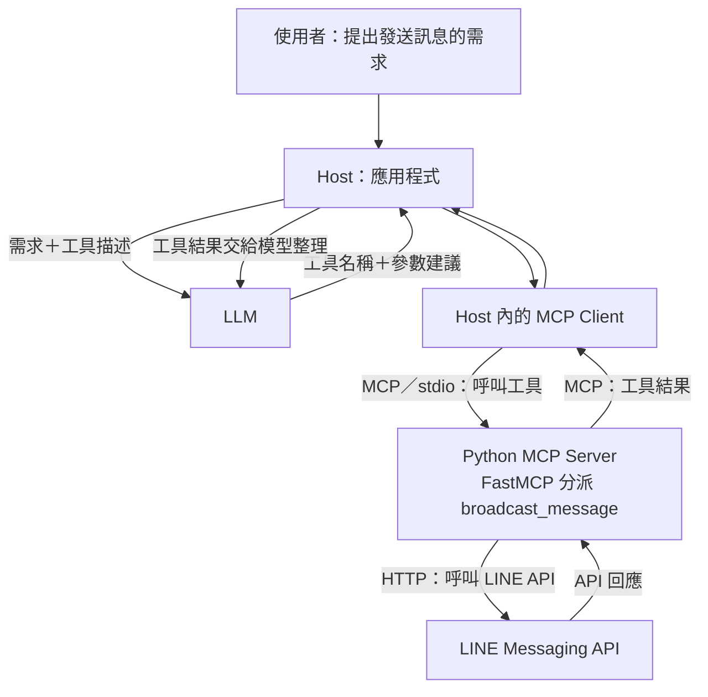
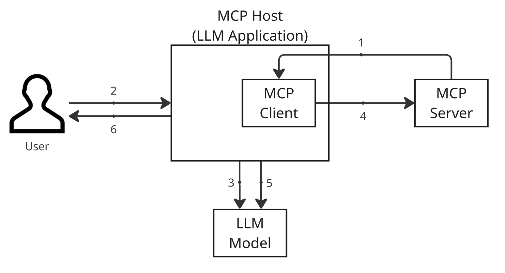

# MCP(model context protocol)

MCP 有無使用 LLM 的差異:  


如果想要在 Line 的開源程式庫 Armeria 搜尋特定 code，然後寫 prompt 給 LLM 應用程式(最純粹的 LLM，無提供外部資料 RAG，也無工具)，這個 LLM 就會根據訓練資料回應，而不會真的去 Github 查 Armeria 程式庫。就可能導致 _Ai Hallucination_。

## Architecture & Flowchart

MCP 採用 client-server 架構


但如果用 GitHub MCP， LLM 應用程式會實際去 GitHub 查 Armeria repo 裡的程式碼。
要做到這件事情就必須要有 MCP server， LLM 還要能呼叫這個 MCP。
這個讓 LLM 能用外部功能的協定就叫 MCP。



| 元件     | 文章使用                         | 實際責任                                       |
| :------- | :------------------------------- | :--------------------------------------------- |
| Host     | Claude Desktop                   | 接收 User require、integrate LLM、安排工具執行 |
| Client   | Claude Desktop 內部的 MCP Client | 與 Server 通訊                                 |
| Server   | 作者寫的 Python program          | 公開並執行 broadcast_message 工具              |
| FastMCP  | Server 使用的框架                | 處理工具註冊與 MCP 通訊                        |
| 外部服務 | Line Messaging API               | 真正向Line User 發送訊息                       |

## 運作方式



1. MCP host 啟動時，會透過 MCP client 呼叫 MCP server 的 tools/list endpoint，取得可用工具清單。
2. 使用者送出 prompt 到 MCP host。
3. MCP host 把使用者 prompt 和工具清單傳給 LLM 模型，LLM 模型會決定要用哪些工具。
4. MCP host 透過 MCP client 呼叫 MCP server 的 tools/call endpoint 使用工具。
5. MCP host 把 MCP server 回傳的工具結果和原本的 prompt 一起傳給 LLM 模型，LLM 會根據這些資訊產生最終回應。
6. MCP host 處理 LLM 模型的最終回應，並傳給使用者。

## 疑惑

1.  | 比較           | RAG                          | MCP                                    |
    | -------------- | ---------------------------- | -------------------------------------- |
    | 屬於什麼       | 利用檢索結果輔助生成的方法   | 應用程式與外部能力溝通的協定           |
    | 主要解決       | 回答時如何利用相關資料       | 如何以共同規格發現、呼叫工具及存取資源 |
    | 會不會自行搜尋 | 需要搭配檢索系統             | 需要 Server 提供對應能力               |
    | 保證資料最新嗎 | 不保證，取決於資料來源與更新 | 不保證，取決於 Server 實際查什麼       |

2.  RAG 本身是一種流程，而不是工具

```
使用者問題
    ↓
檢索系統找出相關資料
    ↓
問題＋檢索結果 → LLM → 回答
```

3.  API 本身就可以呼叫工具，為何還需要 MCP?

```
直接 API：
Host → 自己寫的 LINE 串接程式 → LINE API

使用 MCP：
Host → MCP Client → LINE MCP Server → LINE API
```

希望工具被多個支援 MCP 的應用程式重用：當不同應用程式要使用不同服務時，能不能重用一致的工具發現與呼叫方式

## Reference

| Name                                                                                                                                                          | Author      |
| :------------------------------------------------------------------------------------------------------------------------------------------------------------ | :---------- |
| [MCP 介紹：用 LINE Messaging API 打造 MCP 伺服器](https://techblog.lycorp.co.jp/zh-hant/introduction-to-mcp-and-building-mcp-server-using-line-messaging-api) | Changgu Han |
| [What is MCP](https://www.youtube.com/watch?v=7j1t3UZA1TY)                                                                                                    |
