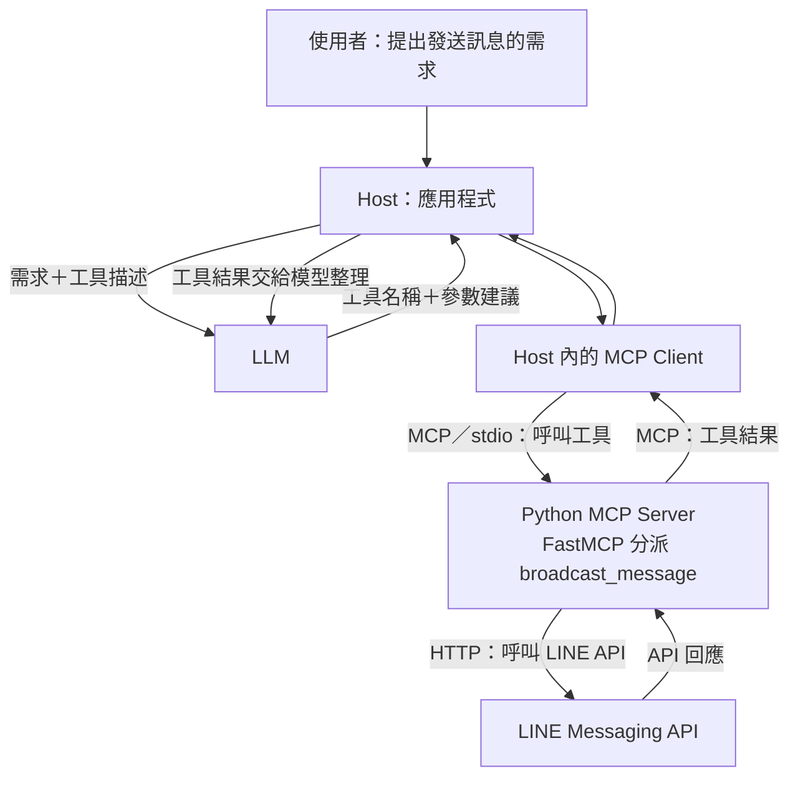
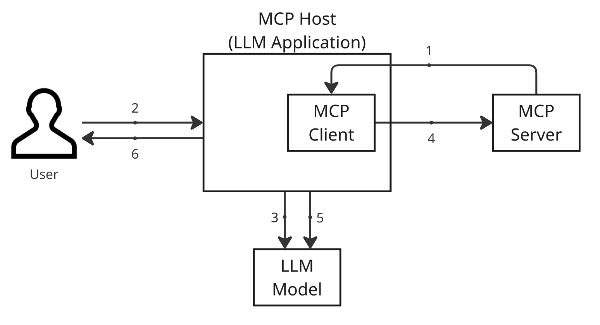

# MCP(model context protocol)

MCP 有無使用 LLM 的差異:  

## Architecture & Flowchart

MCP 採用 client-server 架構

| 元件     | 文章使用                         | 實際責任                                       |
| :------- | :------------------------------- | :--------------------------------------------- |
| Host     | Claude Desktop                   | 接收 User require、integrate LLM、安排工具執行 |
| Client   | Claude Desktop 內部的 MCP Client | 與 Server 通訊                                 |
| Server   | 作者寫的 Python program          | 公開並執行 broadcast_message 工具              |
| FastMCP  | Server 使用的框架                | 處理工具註冊與 MCP 通訊                        |
| 外部服務 | Line Messaging API               | 真正向Line User 發送訊息                       |

## 運作方式

1. MCP host 啟動時，會透過 MCP client 呼叫 MCP server 的 tools/list endpoint，取得可用工具清單。
2. 使用者送出 prompt 到 MCP host。
3. MCP host 把使用者 prompt 和工具清單傳給 LLM 模型，LLM 模型會決定要用哪些工具。
4. MCP host 透過 MCP client 呼叫 MCP server 的 tools/call endpoint 使用工具。
5. MCP host 把 MCP server 回傳的工具結果和原本的 prompt 一起傳給 LLM 模型，LLM 會根據這些資訊產生最終回應。
6. MCP host 處理 LLM 模型的最終回應，並傳給使用者。

## reference

| Name                                                                                                                                                          | Author      |
| :------------------------------------------------------------------------------------------------------------------------------------------------------------ | :---------- |
| [MCP 介紹：用 LINE Messaging API 打造 MCP 伺服器](https://techblog.lycorp.co.jp/zh-hant/introduction-to-mcp-and-building-mcp-server-using-line-messaging-api) | Changgu Han |
